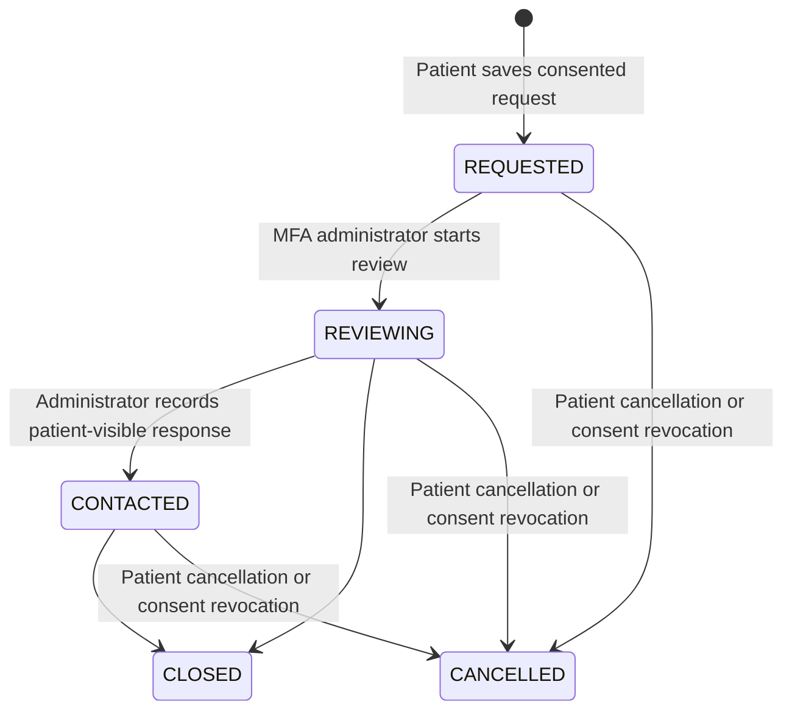

# CareNest care discovery and home care

The visual direction is in [the interactive design brief](CARENEST_DESIGN_DIRECTION.html). It adapts the supplied Workspace proposal to CareNest: neutral light/dark surfaces, cobalt actions, readable type and service choices before provider lists. Existing photography and fonts are reused; sample clinicians remain labelled.

## Available paths

| Path | Behaviour |
| --- | --- |
| `/` | Clinic, video, home and pet care; a real upcoming appointment when present; one provider list. |
| `/home-care` | Nursing, doctor home visits and residential elder/nursing care. |
| `/home-care?for=pet` | Veterinary nursing, vet visits, boarding and assisted stays. |
| `/home-care/request?service=nursing&for=human` | Signed-in, consented care request. `service` also accepts `doctor_visit` and `care_home`; `for` accepts `pet`. |
| `/account/home-care` | The account's requests, review responses and cancellation. |
| `/admin/home-care` | MFA administrator review queue, limited to active, consented requests from active accounts. |
| `/search?home=1`, `/pets?home=1` | Existing doctor/vet home-visit discovery and booking. Hosted sample clinicians cannot advertise home visits; local sample workflows remain available. |

A care request does **not** reserve a clinician, nurse or bed. It does not create a payment, payout, appointment or outbound message. A coordinator must review suitability, partner availability and a quote. Existing doctor bookings, Cashfree sandbox checkout, consultation reminders and LiveKit flows retain their own rules.

## Request lifecycle



“Response recorded” describes `CONTACTED` in the interface; saving a note does not prove a phone call or message was delivered. Closed and cancelled requests cannot be reopened through the current actions. Review notes are visible to the account holder, so do not use them for internal-only comments.

## Data and safeguards

Migration `0016-home-care-requests` adds `patient.home_care_requests`; earlier migration checksums remain unchanged. Request IDs are opaque text identifiers. Service/audience/status/time-window fields have database checks; dates use PostgreSQL `DATE`, revisions use `INTEGER`, and timestamps use `TIMESTAMPTZ`. Human subjects are the account holder or an owned family member; pet requests require an owned, active pet.

Optional care notes and the latest review response are encrypted together with the existing envelope mechanism under the `home-care:<request-id>` context. City/PIN and desired dates remain queryable operational fields. No street address is collected in this request; an actual doctor home-visit booking uses the existing owned, encrypted address flow. Key rotation includes the new envelope context. Reviewed retention redaction also removes care notes and location, and active care requests prevent account erasure until resolved or cancelled.

A client request key and server-computed payload hash make retries idempotent. Reusing the key with different details returns a conflict. Revision checks prevent stale admin updates or cancellations. Ownership and active-account checks run inside the service, independently of client controls.

The initial coordination limits are **3 new requests per account per one-hour fixed window** and **60 globally per hour**. They reuse the shared fixed-window database limiter; they are not a sliding-window guarantee. These conservative MVP limits protect a manually reviewed queue. Idempotent retries do not consume another request. Increase limits only with staffing and abuse monitoring; failed validation does not consume the request budget.

## Run and review locally

With the existing local app stopped:

```powershell
npm install
npm run backup:local
npm run migrate:local
npm run dev -- --webpack
```

Use the configured local sign-in flow, then open Home Care. Local console-code QA is a separate process configuration; it does not replace the saved SMS provider. The temporary QA preview disables outbound sending and has no worker. Never use console OTP on a hosted deployment.

For a persistent hosted database, back up and inspect the intended CareNest target before applying migration 0016. Apply it before deploying this branch; readiness checks require the latest migration. Do not reuse another project's database or export a production connection string into a repository file. This branch has not migrated or deployed the hosted database.

## Verification evidence

- GitHub's exact-commit verification passed **373 tests**, type checks, dependency audits and the production build: [verification run](https://github.com/champion19007/carenest/actions/runs/40370631489). Coverage was 75.56% lines, 77.63% branches and 80.94% functions. The local post-update regression run also passed 371 tests before the last two focused regression cases were added.
- Targeted tests execute the request service against disposable PostgreSQL-compatible databases: ownership, consent, valid dates/PINs, idempotent retries, encrypted persistence, atomic budgets, MFA review, stale revisions and cancellation.
- Twenty focused tests passed after the dependency updates, including privacy restriction, hosted discovery, review-control progression and real key rotation. The PR records the final full-suite result.
- Retention tests check active-request erasure protection and redaction. The actual key-rotation command tests readability of the new envelope after rotation.
- Local browser QA used a fictional account and pet: nursing request → saved history → cancellation; invalid pet-stay dates → preserved form draft → corrected date range → saved history → cancellation. All created care requests were cancelled. No real service was arranged.
- Mobile filters opened a native modal with focus inside it; Escape closed it and restored focus to the filter button. Home-visit filters survived a subsequent text search.
- Discovery layouts were inspected at 320, 390, 768, 1024 and 1440px, including light and dark themes. Main text pairs measured at least 5.60:1 and input boundaries at least 3.25:1 in the checked palette. This is targeted accessibility verification, not a formal conformance audit.
- Browser screenshots are private local QA artifacts in `.data/home-care-qa/`. Public deployment browser QA has not been performed for this change.

## Design delivery gate

Scope: the new public discovery and patient request experience, with backend and rendered-component checks for the private review controls. This is not a claim of a full-product accessibility audit. Owner/admin browser acceptance and real partner fulfilment remain release checks.

| Check | Result and evidence |
| --- | --- |
| R-02, punctuation | PASS: new visible care copy uses ordinary punctuation and date ranges. |
| R-03, layout | PASS: measured document widths did not exceed the tested 320/390/768/1024/1440px viewports. |
| R-17, statistics | PASS: no invented usage or outcome metrics; provider figures come from stored profiles labelled as samples where applicable. |
| R-18, testimonials | PASS: no testimonials added. |
| R-23, assets | PASS: existing logo, avatars, photography and icon dependency reused; new navigation follows the requested home-care scope. |
| R-24, destinations | PASS: Home Care, owned request history and service request routes exist; request links preserve service/audience through sign-in. |
| R-25, contrast | PASS: checked normal-text pairs are at least 5.60:1; checked input boundaries are at least 3.25:1. |
| R-26, controls | PASS: person/pet selection, service fields, validation, save, history and cancellation were exercised; administrator transitions also have service/component tests. |
| R-27, states | PASS: empty history, loading skeleton, pending buttons, validation feedback and retry error boundary are implemented. |
| R-28, FAQ | PASS: no filler FAQ added. |
| R-32, keyboard | PASS: native form controls and visible focus styles; mobile filter modal contains focus and Escape returns it to the trigger. |
| R-33, implementation | PASS: product behaviour and styles are in committed application sources; QA launch scripts are private tooling, not runtime patches. |
| R-34, themes | PASS: light and dark screenshots inspected; a system preference option is available. |
| R-35, runtime | PASS for the recorded patient journeys: real local app save/validation/history/cancellation, modal and URL-filter persistence; production builds passed. Private review controls have separate automated coverage; no administrator browser sign-off is claimed. |
| R-36, trust claims | PASS: no certification, guaranteed fulfilment or security certification claims added. |
| R-37, direction | PASS: supplied Workspace and medical-mobile references; Energy 2 / Rhythm 2 / Motion 1 recorded in the design brief. |
| R-38, content | PASS: sample clinicians remain identified; no invented nurses, care-home beds or partner relationships are listed. |
| R-01, colour effects | PASS: new discovery surfaces use flat neutral colours and cobalt actions; decorative gradients removed from these shared controls. |
| R-04, icons | PASS: stethoscope identifies visits, house identifies home/residential care, paw identifies pet care, and calendar identifies appointments. |
| R-06, type | PASS: existing readable Inter/Jakarta fonts retained; new field labels use sentence case and 14px or larger text. |
| R-07, texture | PASS: no decorative background grid added. |
| R-08, arrows | PASS: arrows identify forward navigation or submission; status, selection and cancellation do not rely on decorative arrows. |
| R-09, badges | PASS: sample-profile and lifecycle labels communicate actual data states. |
| R-10, glass | PASS: no glassmorphism added. |
| R-12, elevation | PASS: new content panels are flat; modal backdrop separates a temporary interaction layer. |
| R-13, glow | PASS: no glow treatment added. |
| R-14, composition | PASS: service rows, care-entry grid and provider panels serve different comparison tasks. |
| R-19, motion | PASS: no entrance choreography; existing reduced-motion support retained. |
| Liveliness: dials | PASS: the brief explicitly sets Energy 2 / Rhythm 2 / Motion 1. |
| Liveliness: hierarchy | PASS: one visible primary heading; service selection precedes the provider list. |
| Liveliness: spacing | PASS: large discovery introduction, compact navigation, separated care rows and grouped provider comparisons. |
| Liveliness: accent | PASS: cobalt identifies the main action and selected state; neutral surfaces carry content. |
| Liveliness: identity | PASS: repeated person/pet counterparts connect discovery, nursing, visits and supported stays. |
| C-1, intent | PASS: visual decisions and their product purpose are recorded above and in the brief. |
| C-2, function | PASS for tested journeys: invalid dates preserve a draft; a corrected stay persists; cancellation updates the saved state. |
| C-3, content | PASS: duplicate provider lists and the large empty appointment banner were removed. |
| C-4, resilience | PASS within tested scope: phone/tablet/desktop, light/dark, pending/empty/error feedback and modal focus. |
| C-5, evidence | PASS: no fabricated testimonials, availability or conversion claims. |
| R-05, rhythm | PASS: navigation, care coordination and clinician comparison have distinct layouts rather than repeated marketing sections. |
| R-11, radii | PASS: compact controls and modest panels are distinct from avatars. |
| R-15, action text | PASS: actions name nursing, a stay, a home visit, a request or cancellation. |
| R-16, language | PASS: no AI-product marketing buzzwords added. |
| R-20, specificity | PASS: household/pet separation and clinical versus residential care drive the page content. |
| R-21, default theme | PASS: saved choices and system preference determine the theme; dark is not forced. |
| R-29, palette | PASS: neutral canvas/surfaces plus cobalt; semantic status colours retain their existing role. |
| R-30, references | PASS: the supplied reference guides readability and restraint, while CareNest retains its own branding and care workflows. |
| R-31, rationale | PASS: the design brief records palette, typography, spacing, photography reuse and care-first page anatomy. |

## Operational work before offering fulfilment

Onboard and verify real nurses, doctors/vets, residential care and boarding partners. Establish service areas, capacity, qualifications, care-suitability review, quotes, contact ownership and response times. The current model is a coordination queue, not a nurse marketplace or bed-inventory system. A real operator must monitor `/admin/home-care`; automatic notification routing is not added for these requests.

Do not present medical boarding and ordinary pet boarding as interchangeable. Partners must decide whether the requested assistance is suitable and whether veterinary supervision is needed. Existing human and veterinary records remain separate.
